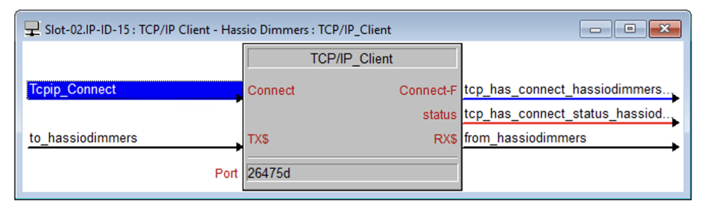
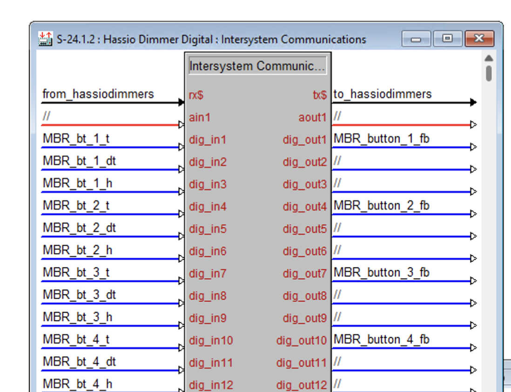
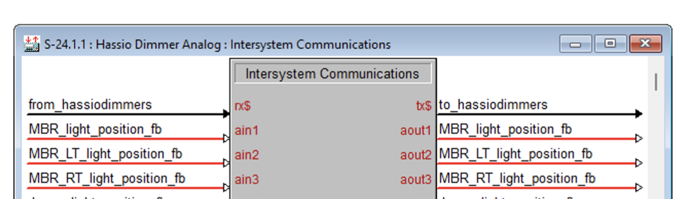
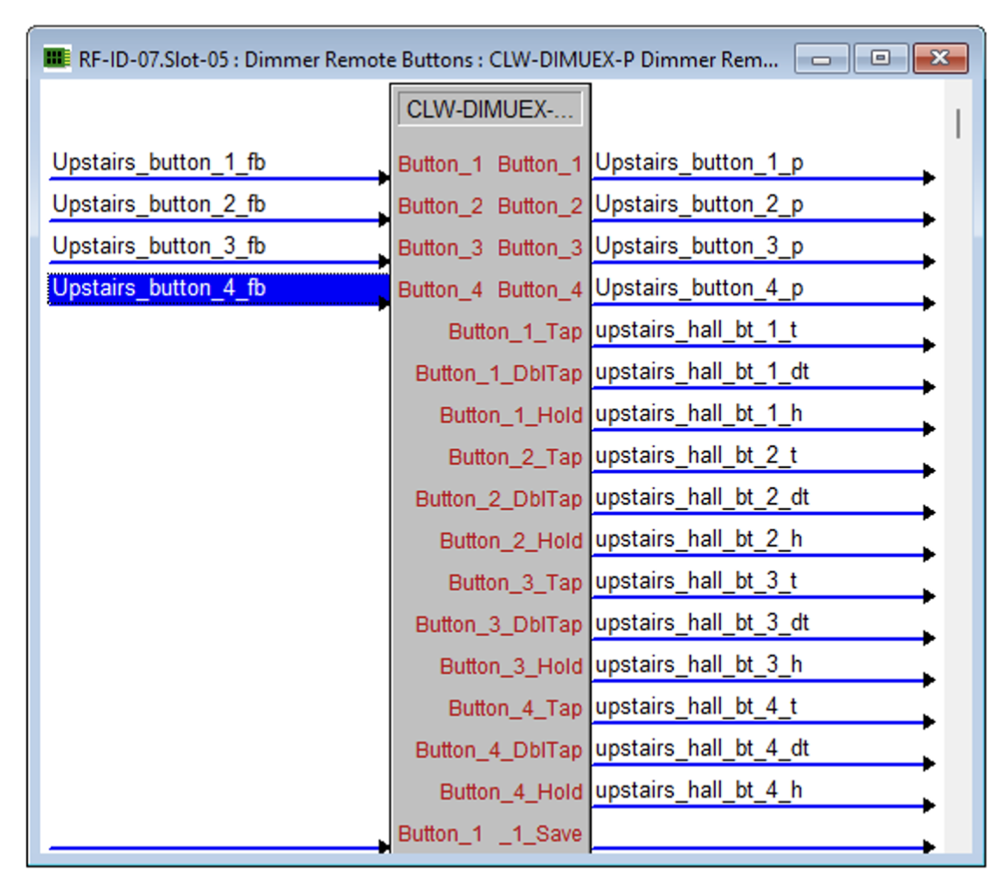

# Crestron programming

Covers: XSIG setup, separate XSIG symbols, join types and direction.
Last verified: 2026-11-22 (split from README.md; content not re-verified)

## Crestron Programming

### XSIG Setup

In your Crestron SIMPL Windows program:

1. **Add a TCP/IP Client symbol** to your program
   - This handles the network connection to Home Assistant
   - Configure the IP address of your Home Assistant server
   - Set the port number (default: 16384) - **must match your HA configuration**

   

2. **Add an Ethernet Intersystem Communication (XSIG) symbol**
   - This symbol translates between TCP and join signals
   - Wire the TCP Client's **Connect_F** to XSIG's **Connect_F**
   - Wire the TCP Client's **Tx$** (transmit) to XSIG's **From_Client$**
   - Wire the XSIG's **To_Client$** to TCP Client's **Rx$** (receive)

3. **Connect XSIG signals to your logic**
   - Map digital, analog, and serial signals as needed
   - Connect joins to your devices, keypads, sensors, etc.

   **Digital signals example:**
   

   **Analog signals example:**
   

   **Dimmer/Keypad button example:**
   

4. **Compile and load the program**

**Important:** The port number is configured on the **TCP/IP Client symbol**, not the XSIG symbol. This port must match the port configured in your Home Assistant Crestron integration.

### Best Practice: Use Separate XSIG Symbols

**Recommended setup:** Use separate XSIG symbols for different join types, all connected to the same TCP/IP Client.

**Why separate symbols?**

When you mix analog and digital signals on the same XSIG symbol, join numbering becomes confusing. Even though digital signals appear numbered "1, 2, 3..." on the symbol, they're actually transmitted using sequential join numbers that continue after all analog signals.

**Example of the problem:**
- You attach 25 analog signals to an XSIG (a1-a25)
- Then attach 10 digital signals below them
- The digitals show as "1-10" on the XSIG symbol
- But they're actually transmitted as joins **26-35** (continuing the sequence)
- In Home Assistant, you'd need to use `d26`, `d27`, etc., not `d1`, `d2`

**Recommended approach:**
1. **XSIG #1:** Analog and Serial joins only
   - All analog signals (temperature, brightness, position, etc.)
   - All serial signals (text, strings)
   - Join numbers match what you see on the symbol (a1 = a1, a2 = a2, etc.)

2. **XSIG #2:** Digital joins only
   - All digital signals (button presses, on/off, LEDs)
   - Minimizes join numbering offset (see Digital Join Numbering below)

3. **Wire both XSIGs to the same TCP/IP Client:**
   - Both XSIG symbols share the same TCP connection
   - Each XSIG's To_Client$/From_Client$ wires to the TCP Client's Rx$/Tx$
   - Use serial join combiners if needed for multiple XSIGs

**Digital Join Numbering Rule:**

The XSIG symbol numbers signals sequentially across ALL join types. What you see labeled on the symbol (1, 2, 3...) is NOT the actual join number transmitted.

Digital joins are numbered **after all analog join slots** on that symbol, even if those analog slots are unused.

**Example - Dedicated Digital XSIG:**
- XSIG symbol has analog slots (even if unused): 1, 2, 3
- SIMPL shows "Digital 1", "Digital 2", "Digital 3"
- Actual joins transmitted: d4, d5, d6
- In Home Assistant, use: `d4`, `d5`, `d6` (not d1, d2, d3)

**To determine the offset:**
1. Count how many analog join slots appear on your XSIG symbol (even if unused)
2. Add that number to the digital label shown in SIMPL
3. Example: If symbol has 3 analog slots, "Digital 5" = `d8` in HA (5 + 3 = 8)

**Best practice:** Use a dedicated digital-only XSIG symbol with minimal analog slots to keep the offset small and predictable. This makes troubleshooting much easier.

### Join Types

- **Digital joins (d)** - Boolean values (true/false, on/off, button presses)
- **Analog joins (a)** - Numeric values (0-65535)
  - Temperature setpoints: multiply by 10 (e.g., 72.5°F = 725)
  - Brightness: 0-255
  - Position: 0-100
  - Dimmer levels: 0-65535 (0=off, 1-65535=on with brightness)
- **Serial joins (s)** - Text strings

### Join Direction

- **TO Crestron (Output)** - Home Assistant sends values to Crestron
  - LED feedback
  - Setpoints
  - State synchronization
- **FROM Crestron (Input)** - Crestron sends values to Home Assistant
  - Button presses
  - Sensor readings
  - Status feedback

Note: The same join number can be used for both directions (e.g., d10 for button press AND LED feedback).
